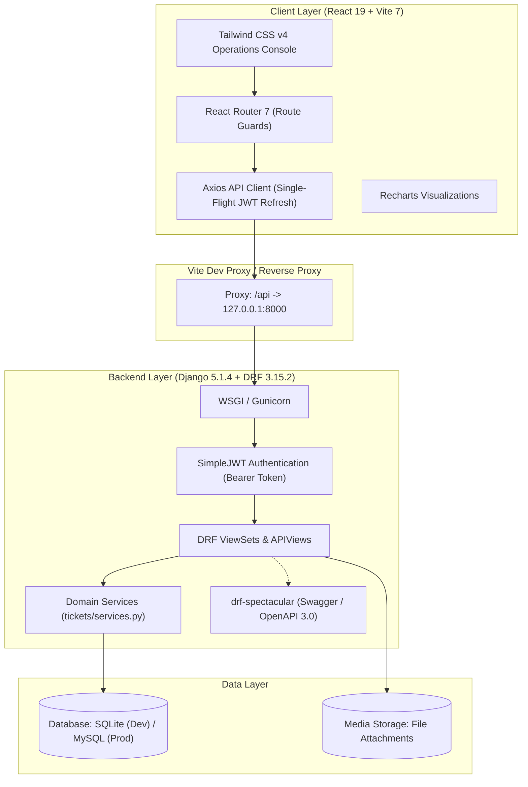
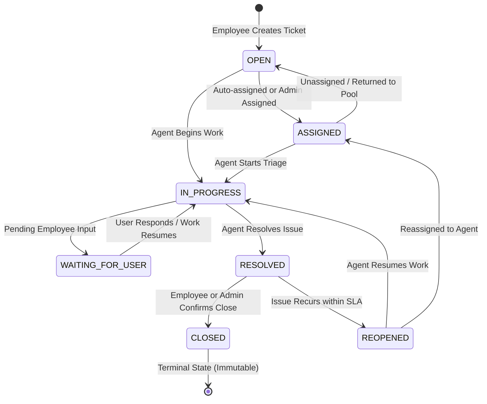
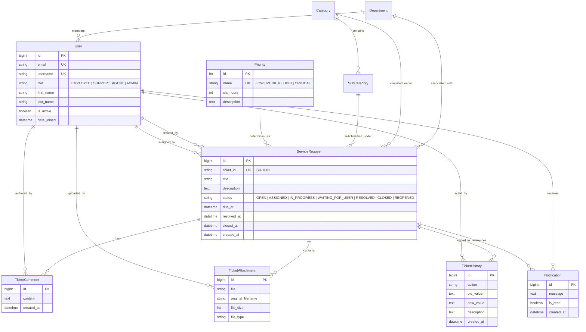

# ServiceDesk — IT Service Request & Ticket Management System

[](https://www.python.org/)
[](https://www.djangoproject.com/)
[](https://www.django-rest-framework.org/)
[](https://react.dev/)
[](https://vitejs.dev/)
[](https://tailwindcss.com/)
[](https://swagger.io/)
[](https://www.sqlite.org/)

> **A modern, full-stack enterprise IT service desk platform featuring automated ticket routing, SLA lifecycle management, immutable audit logging, multi-tier role-based access control, real-time analytics dashboards, and an interactive React operations console.**

---

## Table of Contents

- [1. Project Overview](#1-project-overview)
  - [The Problem It Solves](#the-problem-it-solves)
  - [Target Audience & Personas](#target-audience--personas)
  - [Core Value Proposition](#core-value-proposition)
- [2. System Architecture](#2-system-architecture)
  - [High-Level Architecture](#high-level-architecture)
  - [Ticket State Machine](#ticket-state-machine)
  - [API Envelope Standard](#api-envelope-standard)
- [3. Features in Detail](#3-features-in-detail)
  - [Authentication & User Management](#authentication--user-management)
  - [Intelligent Ticketing & Auto-Assignment](#intelligent-ticketing--auto-assignment)
  - [SLA Tracking Engine](#sla-tracking-engine)
  - [Collaboration, Attachments & Audit Logging](#collaboration-attachments--audit-logging)
  - [Role-Specific Dashboards](#role-specific-dashboards)
  - [Administrative Reports & Analytics](#administrative-reports--analytics)
- [4. Technology Stack](#4-technology-stack)
- [5. Repository Directory Structure](#5-repository-directory-structure)
- [6. Prerequisites](#6-prerequisites)
- [7. Installation and Local Setup](#7-installation-and-local-setup)
  - [Step 1: Clone the Repository](#step-1-clone-the-repository)
  - [Step 2: Backend Setup (Django)](#step-2-backend-setup-django)
  - [Step 3: Frontend Setup (React + Vite)](#step-3-frontend-setup-react--vite)
  - [Step 4: Access the Application](#step-4-access-the-application)
- [8. Default Demo Credentials](#8-default-demo-credentials)
- [9. Environment Variables & Configuration](#9-environment-variables--configuration)
  - [Backend Environment Variables (`backend/.env`)](#backend-environment-variables-backendenv)
  - [Frontend Environment Variables (`frontend/.env`)](#frontend-environment-variables-frontendenv)
- [10. Database Schema & Data Models](#10-database-schema--data-models)
  - [Entity-Relationship Overview](#entity-relationship-overview)
  - [Database Operations](#database-operations)
- [11. API Documentation](#11-api-documentation)
  - [Interactive Documentation](#interactive-documentation)
  - [REST API Endpoints Catalog](#rest-api-endpoints-catalog)
  - [Representative Request & Response Samples](#representative-request--response-samples)
- [12. Frontend Implementation & UI Components](#12-frontend-implementation--ui-components)
- [13. Security & Access Control](#13-security--access-control)
- [14. Testing & Verification](#14-testing--verification)
- [15. Deployment Guide](#15-deployment-guide)
  - [Option A (Recommended): Frontend on Vercel + Backend on Render/Railway](#option-a-recommended-frontend-on-vercel--backend-on-renderrailway)
  - [Option B: Monorepo Deployment on Vercel](#option-b-monorepo-deployment-on-vercel)
- [16. Troubleshooting](#16-troubleshooting)
- [17. Performance & Scalability](#17-performance--scalability)
- [18. Project Roadmap](#18-project-roadmap)
- [19. Contributing](#19-contributing)
- [20. License](#20-license)
- [21. Authors & Contact](#21-authors--contact)
- [22. Frequently Asked Questions (FAQ)](#22-frequently-asked-questions-faq)

---

## 1. Project Overview

### The Problem It Solves
Internal technical support in growing organizations frequently suffers from:
* Lost or unrecorded support requests sent across informal channels (email, chat, verbal).
* Missed SLA (Service Level Agreement) deadlines due to manual ticket assignment and lack of countdown visibility.
* Unequal agent workloads where tickets pile up on single engineers while others remain idle.
* Missing audit trails when tickets are reassigned, escalated, or closed without documented justification.
* Lack of actionable reporting on department infrastructure health and recurring failure categories.

**ServiceDesk** resolves these bottlenecks by providing a unified, auditable, and automated ticket lifecycle platform.

### Target Audience & Personas
The system defines three distinct operational personas:
1. **Employees (End Users)**: Submit technical requests with category/subcategory classification, track real-time resolution progress, upload diagnostic attachments, and communicate with support staff via threaded comments.
2. **Support Agents (IT Technicians)**: View incoming tickets automatically routed according to existing workload, transition ticket statuses through an enforced state machine, resolve issues within priority SLA deadlines, and access dedicated agent operational dashboards.
3. **Administrators (IT Managers)**: Manage organizational departments, service categories, subcategories, user accounts, and priority SLA definitions; execute bulk ticket actions; and monitor organizational health via interactive SVG charts and CSV-exportable compliance reports.

### Core Value Proposition
* **Automated Least-Busy Routing**: Automatically assigns incoming tickets to active support agents with the lowest current workload upon creation.
* **Deterministic SLA Engine**: Automatically calculates exact deadlines (`due_at`) from database-backed priority levels and tracks countdown states (`WITHIN_SLA`, `NEAR_SLA`, `OVERDUE`).
* **Enforced State Machine**: Guarantees ticket integrity by strictly validating permitted state transitions (e.g., preventing direct transitions from `OPEN` to `CLOSED`).
* **Immutable Audit Trail**: Records an append-only change history for every ticket event (status changes, assignments, comments, attachments).
* **Single-Flight JWT Authentication**: React frontend implements an Axios interceptor that queues concurrent 401 requests during token refresh to avoid session dropouts.

---

## 2. System Architecture

### High-Level Architecture



### Ticket State Machine

All ticket status transitions are strictly validated against a finite state machine defined in [`backend/tickets/models.py`](file:///d:/Django%20Projects/Service%20Desk%20Management%20System/backend/tickets/models.py):



### API Envelope Standard

All API endpoints follow a consistent JSON envelope defined in [`backend/common/responses.py`](file:///d:/Django%20Projects/Service%20Desk%20Management%20System/backend/common/responses.py):

#### Success Response
```json
{
  "success": true,
  "message": "Tickets retrieved successfully.",
  "data": { ... }
}
```

#### Paginated Success Response
```json
{
  "success": true,
  "message": "Data retrieved successfully.",
  "count": 42,
  "next": "http://127.0.0.1:8000/api/tickets/?page=2",
  "previous": null,
  "total_pages": 5,
  "current_page": 1,
  "results": [ ... ]
}
```

#### Error Response
```json
{
  "success": false,
  "message": "Invalid state transition.",
  "errors": {
    "status": ["Cannot transition directly from OPEN to CLOSED."]
  }
}
```

---

## 3. Features in Detail

### Authentication & User Management
* **Email-Based Authentication**: Custom user model (`accounts.User`) uses email instead of username as the primary credential.
* **Role-Based Token Claims**: JWT access tokens embed claims (`role`, `email`, `full_name`, `is_active`), allowing instant frontend routing without supplementary network round-trips.
* **Token Rotation & Blacklist**: Refresh tokens rotate upon use; previous tokens are immediately invalidated in `token_blacklist`.
* **Administrative User Control**: Admins can create accounts, toggle active/inactive status, and filter users by role, department, or activation state.
* **Password Management**: In-app password change for authenticated users, alongside an email-token password reset workflow.

### Intelligent Ticketing & Auto-Assignment
* **Sequential Identifiers**: Tickets receive readable sequential IDs (e.g., `SR-1001`, `SR-1002`) generated automatically upon creation.
* **Least-Busy Agent Routing**: Upon creation, `auto_assign_ticket()` evaluates active support agents using an aggregate query to count active tickets (`OPEN`, `ASSIGNED`, `IN_PROGRESS`, `WAITING_FOR_USER`) and automatically assigns the least busy agent.
* **Category & Subcategory Hierarchy**: Dependent category dropdowns allow precise classification (e.g., `Software` → `Operating System`, `Hardware` → `Monitor`).
* **Admin Bulk Actions**: Admins can select multiple tickets in the UI to perform bulk status updates, bulk assignments, or bulk closures in a single operation (`POST /api/tickets/bulk-actions/`).

### SLA Tracking Engine
* **Configurable SLA Hours**: Stored in the database per priority level (`CRITICAL: 2h`, `HIGH: 8h`, `MEDIUM: 24h`, `LOW: 72h`), allowing admins to adjust SLAs dynamically without code deployments.
* **Automated Due Date Computation**: Sets `due_at = created_at + timedelta(hours=priority.sla_hours)`.
* **Dynamic SLA Status**:
  * `WITHIN_SLA`: Time remaining exceeds 2 hours.
  * `NEAR_SLA`: Due date is within 2 hours.
  * `OVERDUE`: Current time exceeds `due_at` and ticket is not resolved.
  * `RESOLVED_WITHIN_SLA`: Resolution occurred before `due_at`.
  * `RESOLVED_AFTER_SLA`: Resolution occurred after `due_at`.

### Collaboration, Attachments & Audit Logging
* **Threaded Ticket Comments**: Authenticated discussion between ticket owners and assigned agents. Editing and deletion are restricted to the comment author or admins.
* **Sanitized File Attachments**: Files are validated against maximum size (default 10 MB) and allowed MIME types (images, PDF, Word, Excel, text, CSV, ZIP). Saved under collision-free UUID paths: `attachments/SR-XXXX/<uuid>.<ext>`.
* **Immutable Audit History**: Every lifecycle event creates an immutable `TicketHistory` entry tracking action, actor, timestamp, old value, and new value.

### Role-Specific Dashboards
* **Employee Dashboard**: Ticket summary cards (Total, Active, Resolved), quick-create shortcut, and a table of personal active requests with SLA badges.
* **Agent Dashboard**: Assigned queue count, urgent ticket counter, near-SLA countdown alerts, and quick status action buttons.
* **Admin Dashboard**: System-wide status distribution, priority breakdown charts (SVG rendered via Recharts), department volume, and agent workload distribution.

### Administrative Reports & Analytics
* **Filterable Reporting Suite**: Generate analytics filtered by date range presets (`today`, `last7`, `last30`, `custom`).
* **SLA Performance Metrics**: Compliance rate percentage calculation (`(resolved_within_sla / total_resolved) * 100`).
* **Overdue Tickets Report & CSV Export**: Detailed tabular view of breached tickets with direct client-side CSV export capability.

---

## 4. Technology Stack

| Layer | Technology | Verified Version | Purpose in Project |
|---|---|---|---|
| **Backend Framework** | Django | 5.1.4 | Core web framework, ORM, migrations, and admin panel |
| **API Framework** | Django REST Framework | 3.15.2 | RESTful serializers, generic views, and request handling |
| **Authentication** | SimpleJWT | 5.3.1 | JSON Web Token (JWT) generation, refresh rotation, and blacklist |
| **API Documentation** | drf-spectacular | 0.27.2 | OpenAPI 3.0 schema generation and Swagger/ReDoc UIs |
| **Query Filtering** | django-filter | 24.3 | Declarative URL query parameter filtering for ticket lists |
| **CORS Handling** | django-cors-headers | 4.6.0 | Cross-Origin Resource Sharing middleware |
| **Configuration** | python-decouple | 3.8 | Strict separation of secrets and environment configuration |
| **Image Processing** | Pillow | 11.1.0 | Validation and handling of user profile avatars |
| **Production Server** | Gunicorn | 23.0.0 | WSGI HTTP production application server |
| **Database (Dev)** | SQLite 3 | 3.x (bundled) | Zero-configuration relational database for local development |
| **Database (Prod)** | MySQL / PyMySQL | 1.1.1 | Relational database adapter for production deployment |
| **Frontend Framework** | React | 19.2.0 | Modern declarative component-driven UI layer |
| **Build Tool** | Vite | 7.1.12 | Fast development server, bundling, and reverse proxy |
| **Routing** | React Router | 7.9.5 | Client-side routing with nested role and auth guards |
| **HTTP Client** | Axios | 1.12.2 | Network requests with single-flight JWT refresh interceptor |
| **Styling** | Tailwind CSS | 4.1.16 | Utility-first design tokens and responsive UI styling |
| **Data Visualization**| Recharts | 3.2.1 | Composable SVG charts for administrative dashboards and reports |
| **Icons** | Lucide React | 0.563.0 | Lightweight, modern icon set |
| **Notifications UI** | React Hot Toast | 2.6.0 | Non-blocking toast notifications for UI actions |
| **Automated Testing** | Chrome DevTools Protocol | Node.js script | Headless browser end-to-end smoke verification (`e2e-smoke.mjs`) |

---

## 5. Repository Directory Structure

```text
Service-Desk-Management-System/
├── .gitignore                          # Comprehensive exclusions (Python, Django, React, Node)
├── PROJECT_PROGRESS.md                 # Detailed implementation ledger and verified test log
├── README.md                           # Master project documentation
│
├── backend/                            # Django REST Framework Backend
│   ├── manage.py                       # Django management CLI entry point
│   ├── requirements.txt                # Pinned Python package dependencies
│   ├── .env                            # Local environment configuration (git-ignored)
│   ├── .env.example                    # Template environment file with safe placeholders
│   ├── db.sqlite3                      # Local development SQLite database
│   │
│   ├── config/                         # Core Project Configuration
│   │   ├── __init__.py
│   │   ├── asgi.py                     # ASGI entry point
│   │   ├── urls.py                     # Root URL routing table
│   │   ├── wsgi.py                     # WSGI entry point
│   │   └── settings/                   # Modular Settings Package
│   │       ├── __init__.py             # Auto-selects dev or prod based on DJANGO_ENV
│   │       ├── base.py                 # Common apps, middleware, JWT, and SLA configuration
│   │       ├── development.py          # Development overrides (DEBUG=True, SQLite database)
│   │       └── production.py           # Production security hardening (HSTS, SSL, Whitenoise)
│   │
│   ├── accounts/                       # User Management & Authentication App
│   │   ├── models.py                   # Custom User model (Role: EMPLOYEE, SUPPORT_AGENT, ADMIN)
│   │   ├── serializers.py              # JWT token claims, registration, and profile serializers
│   │   ├── views.py                    # Auth endpoints (login, register, logout, me, password)
│   │   ├── user_views.py               # Admin endpoints for user CRUD and activation toggles
│   │   ├── permissions.py              # IsAdmin, IsSupportAgent, IsEmployee, IsAdminOrAgent
│   │   ├── urls.py                     # Mounted at /api/auth/
│   │   └── user_urls.py                # Mounted at /api/users/
│   │
│   ├── departments/                    # Department Hierarchy App
│   │   ├── models.py                   # Department entity (IT, HR, Finance, etc.)
│   │   ├── serializers.py              # Department CRUD serializers
│   │   ├── views.py                    # Department list and detail views
│   │   └── urls.py                     # Mounted at /api/departments/
│   │
│   ├── categories/                     # Service Classification App
│   │   ├── models.py                   # Category and SubCategory models
│   │   ├── serializers.py              # Nested category/subcategory serializers
│   │   ├── views.py                    # Category endpoints and subcategory creation
│   │   └── urls.py                     # Mounted at /api/categories/
│   │
│   ├── tickets/                        # Core Ticketing & SLA Engine App
│   │   ├── models.py                   # Priority, ServiceRequest, Comment, Attachment, History
│   │   ├── services.py                 # Business logic: SLA calculations, auto-assign, notifications
│   │   ├── filters.py                  # django-filter FilterSet for search, status, SLA, dates
│   │   ├── permissions.py              # Object-level permissions (IsTicketOwner, CanManageTicket)
│   │   ├── serializers.py              # Ticket create, detail, comment, attachment serializers
│   │   ├── views.py                    # Lifecycle actions (assign, status, resolve, close, bulk)
│   │   ├── urls.py                     # Mounted at /api/tickets/
│   │   └── management/commands/        # Custom Management Commands
│   │       └── seed_data.py            # Idempotent database seeder (UTF-8 console safe)
│   │
│   ├── notifications/                  # In-App Notification App
│   │   ├── models.py                   # Notification entity tied to user and ticket
│   │   ├── serializers.py              # Notification serializers
│   │   ├── views.py                    # List notifications, mark read, mark all read
│   │   └── urls.py                     # Mounted at /api/notifications/
│   │
│   ├── dashboard/                      # Aggregated Analytics App
│   │   ├── views.py                    # Optimized role-specific endpoints (employee, agent, admin)
│   │   └── urls.py                     # Mounted at /api/dashboard/
│   │
│   ├── reports/                        # Executive Reporting App
│   │   ├── views.py                    # Aggregated reports (SLA %, workload, overdue list)
│   │   └── urls.py                     # Mounted at /api/reports/
│   │
│   └── common/                         # Shared Utilities & Middleware
│       ├── exceptions.py               # Custom DRF exception handler
│       ├── pagination.py               # StandardResultsPagination (10 per page, envelope-wrapped)
│       └── responses.py                # Standard envelope helpers (success_response, error_response)
│
└── frontend/                           # React 19 + Vite Frontend SPA
    ├── package.json                    # Frontend dependencies and npm scripts
    ├── vite.config.js                  # Vite configuration, dev proxy, and chunk splitting
    ├── vercel.json                     # SPA routing rewrite rules for Vercel deployment
    ├── index.html                      # HTML5 shell loading Inter font
    ├── .env.example                    # Template for frontend environment variables
    ├── scripts/
    │   └── e2e-smoke.mjs               # Headless Chrome DevTools Protocol E2E test runner
    │
    └── src/
        ├── main.jsx                    # Application bootstrapping and React DOM mounting
        ├── App.jsx                     # Route definitions, layout structure, and route guards
        ├── index.css                   # Tailwind CSS v4 design tokens and theme variables
        │
        ├── api/                        # Network Layer
        │   ├── client.js               # Central Axios instance with single-flight 401 refresh
        │   └── index.js                # Organized API service functions matching backend routes
        │
        ├── context/
        │   └── AuthContext.jsx         # React Context managing session state, login, and logout
        │
        ├── utils/
        │   ├── constants.js            # Status chips, priority badges, and chart color maps
        │   └── format.js               # Date helpers, relative timestamps, and SLA countdowns
        │
        ├── components/
        │   ├── auth/
        │   │   └── RouteGuards.jsx     # ProtectedRoute, GuestRoute, and RoleRoute components
        │   ├── layout/
        │   │   ├── AppLayout.jsx       # Main layout frame containing Sidebar and Topbar
        │   │   ├── Sidebar.jsx         # Role-aware navigation sidebar
        │   │   └── Topbar.jsx          # Header with user avatar and 60s notification polling
        │   └── ui/                     # Reusable Design System
        │       ├── Button.jsx          # Accessible button with loading spinner
        │       ├── Card.jsx            # Surface card and StatCard metric display
        │       ├── Chips.jsx           # Color-coded StatusChip, PriorityChip, and RoleBadge
        │       ├── Form.jsx            # FormField, Input, Select, and Textarea components
        │       ├── Modal.jsx           # Accessible dialog and ConfirmDialog
        │       ├── Table.jsx           # Styled tabular data display
        │       ├── Pagination.jsx      # Page navigation control
        │       └── States.jsx          # LoadingSpinner, EmptyState, and ErrorBanner
        │
        └── pages/                      # Page Views
            ├── NotificationsPage.jsx   # Notification center with mark-read actions
            ├── ProfilePage.jsx         # Profile editing and password change
            ├── auth/                   # Authentication Views
            │   ├── Login.jsx           # Email and password authentication
            │   ├── Register.jsx        # Account registration with department selection
            │   ├── ForgotPassword.jsx  # Password reset request view
            │   └── ResetPassword.jsx   # Token-based password confirmation view
            ├── dashboards/             # Operational Dashboards
            │   ├── Dashboard.jsx       # Role-switching controller
            │   ├── EmployeeDashboard.jsx# Personal ticket overview and quick submission
            │   ├── AgentDashboard.jsx  # Assigned triage queue and SLA countdowns
            │   └── AdminDashboard.jsx  # System health metrics and Recharts graphs
            ├── tickets/                # Ticket Management Views
            │   ├── TicketsPage.jsx     # Filterable list, search, pagination, and bulk actions
            │   ├── TicketCreatePage.jsx# Creation form with dynamic subcategory cascade
            │   └── TicketDetailPage.jsx# Full ticket view, comments, attachments, and history
            └── admin/                  # Administrative Management Views
                ├── UsersPage.jsx       # User administration table and activation modal
                ├── CategoriesPage.jsx  # Category and subcategory configuration
                ├── DepartmentsPage.jsx # Organizational department management
                ├── PrioritiesPage.jsx  # SLA hours configuration per priority level
                └── ReportsPage.jsx     # Analytics suite with date filtering and CSV export
```

---

## 6. Prerequisites

Ensure your system meets the following verified runtime requirements:

* **Python**: `3.10` or higher (verified with Python `3.14.3`).
* **Node.js**: `18.0` or higher (verified with Node.js `v24.11.0`).
* **Package Manager**: `npm` `9.0`+ (verified with `11.6.1`).
* **Git**: Installed and configured on your system path.
* **Database**:
  * Development: SQLite 3 (included with Python, zero installation required).
  * Production: MySQL 8.0+ or PostgreSQL 14+.

---

## 7. Installation and Local Setup

### Step 1: Clone the Repository
```bash
git clone https://github.com/AchutaKumar/Service-Desk-Management-System.git
cd Service-Desk-Management-System
```

---

### Step 2: Backend Setup (Django)

1. **Navigate to the backend directory**:
   ```bash
   cd backend
   ```

2. **Create and activate a virtual environment**:
   * **Windows (PowerShell)**:
     ```powershell
     python -m venv venv
     .\venv\Scripts\Activate.ps1
     ```
   * **Linux / macOS**:
     ```bash
     python3 -m venv venv
     source venv/bin/activate
     ```

3. **Install Python dependencies**:
   ```bash
   pip install -r requirements.txt
   ```

4. **Configure environment variables**:
   Copy the example environment file:
   * **Windows (PowerShell)**:
     ```powershell
     Copy-Item .env.example .env
     ```
   * **Linux / macOS**:
     ```bash
     cp .env.example .env
     ```
   *(The default `.env.example` settings are configured for immediate local SQLite development).*

5. **Apply database migrations**:
   ```bash
   python manage.py migrate
   ```

6. **Seed reference data and demo users**:
   ```bash
   python manage.py seed_data
   ```
   > **Note**: This idempotent command creates 4 priorities with SLA rules, 6 departments, 6 categories with 34 subcategories, and 3 pre-configured demo users across all roles.

7. **Start the Django development server**:
   ```bash
   python manage.py runserver 127.0.0.1:8000
   ```
   The backend API is now running at `http://127.0.0.1:8000/`.

---

### Step 3: Frontend Setup (React + Vite)

1. **Open a new terminal and navigate to the frontend directory**:
   ```bash
   cd Service-Desk-Management-System/frontend
   ```

2. **Install Node packages**:
   ```bash
   npm install
   ```

3. **Start the Vite development server**:
   ```bash
   npm run dev
   ```
   The development server will launch at `http://127.0.0.1:5173/`.

> **Vite Proxy Notice**: In development, Vite automatically proxies all requests from `/api` and `/media` to `http://127.0.0.1:8000`. You do not need to configure CORS or custom URLs during local development.

---

### Step 4: Access the Application

* **Frontend Web Application**: [http://127.0.0.1:5173/](http://127.0.0.1:5173/)
* **Django Administration Panel**: [http://127.0.0.1:8000/admin/](http://127.0.0.1:8000/admin/)
* **Interactive Swagger UI Documentation**: [http://127.0.0.1:8000/api/docs/](http://127.0.0.1:8000/api/docs/)
* **OpenAPI 3.0 Schema**: [http://127.0.0.1:8000/api/schema/](http://127.0.0.1:8000/api/schema/)
* **ReDoc Documentation**: [http://127.0.0.1:8000/api/redoc/](http://127.0.0.1:8000/api/redoc/)

---

## 8. Default Demo Credentials

The `seed_data` command creates three test accounts covering all roles:

| Role | Email Address | Password | Permissions & Dashboard |
|---|---|---|---|
| **Administrator** | `admin@servicedesk.com` | `Admin@1234` | Full access: User management, department/category/SLA configuration, bulk actions, reports. |
| **Support Agent** | `agent@servicedesk.com` | `Agent@1234` | Operational access: Assigned queue triage, status updates, resolution, SLA countdowns. |
| **Employee** | `employee@servicedesk.com` | `Employee@1234` | Self-service access: Submit tickets, track own requests, comment, upload attachments. |

*(For production environments, initialize accounts manually using `python manage.py createsuperuser` and never run `seed_data` with default credentials).*

---

## 9. Environment Variables & Configuration

### Backend Environment Variables (`backend/.env`)

| Variable | Description | Required? | Default / Example Value |
|---|---|:---:|---|
| `SECRET_KEY` | Cryptographic secret for Django security and sessions | **Yes** | `django-insecure-change-this-in-production` |
| `DEBUG` | Enable/disable debug mode (Must be `False` in production) | No | `True` |
| `ALLOWED_HOSTS` | Comma-delimited list of valid host/domain names | No | `localhost,127.0.0.1` |
| `DJANGO_ENV` | Selects settings module (`development` or `production`) | No | `development` |
| `DB_NAME` | Relational database name (used when `DJANGO_ENV=production`) | No | `servicedesk_db` |
| `DB_USER` | Relational database username | No | `root` |
| `DB_PASSWORD` | Relational database user password | No | `your_mysql_password` |
| `DB_HOST` | Database server host address | No | `localhost` |
| `DB_PORT` | Database server port | No | `3306` |
| `EMAIL_BACKEND` | Django email backend class | No | `django.core.mail.backends.console.EmailBackend` |
| `EMAIL_HOST` | SMTP server hostname | No | `smtp.gmail.com` |
| `EMAIL_PORT` | SMTP port | No | `587` |
| `EMAIL_USE_TLS` | Enable TLS encryption for email | No | `True` |
| `EMAIL_HOST_USER` | SMTP authentication username | No | `your_email@gmail.com` |
| `EMAIL_HOST_PASSWORD` | SMTP authentication app password | No | `your_email_password` |
| `DEFAULT_FROM_EMAIL` | Sender address for system-generated notification emails | No | `ServiceDesk <noreply@servicedesk.com>` |
| `JWT_ACCESS_TOKEN_LIFETIME_MINUTES` | Lifetime of JWT access token before refresh | No | `15` |
| `JWT_REFRESH_TOKEN_LIFETIME_DAYS` | Lifetime of JWT refresh token | No | `7` |
| `FRONTEND_URL` | Base URL of frontend application (used in reset emails) | No | `http://localhost:5173` |
| `MAX_UPLOAD_SIZE_MB` | Maximum permitted file upload size in megabytes | No | `10` |

### Frontend Environment Variables (`frontend/.env`)

| Variable | Description | Required? | Default / Example Value |
|---|---|:---:|---|
| `VITE_API_BASE_URL` | Base URL of backend REST API. Leave empty during local dev (uses Vite proxy). In production, set to public API URL. | No | `https://api.yourdomain.com/api` |

---

## 10. Database Schema & Data Models

### Entity-Relationship Overview



### Database Operations

* **Create New Migrations**:
  ```bash
  python manage.py makemigrations
  ```
* **Apply Migrations**:
  ```bash
  python manage.py migrate
  ```
* **Reset Database (Dev Only)**:
  ```bash
  python manage.py seed_data --reset
  ```

---

## 11. API Documentation

### Interactive Documentation
When running locally, explore and test every API endpoint through the interactive Swagger UI:
* **Swagger UI**: [http://127.0.0.1:8000/api/docs/](http://127.0.0.1:8000/api/docs/)
* **ReDoc Interface**: [http://127.0.0.1:8000/api/redoc/](http://127.0.0.1:8000/api/redoc/)

### REST API Endpoints Catalog

#### Authentication & Profile (`/api/auth/`)
| Method | Endpoint | Access Level | Description |
|---|---|---|---|
| `POST` | `/api/auth/register/` | Public | Register a new employee account |
| `POST` | `/api/auth/login/` | Public | Authenticate with email/password; returns JWT pair |
| `POST` | `/api/auth/logout/` | Authenticated | Blacklist refresh token to invalidate session |
| `POST` | `/api/auth/token/refresh/` | Public | Obtain a new access token using a valid refresh token |
| `GET` | `/api/auth/me/` | Authenticated | Retrieve profile details of authenticated user |
| `PATCH` | `/api/auth/me/` | Authenticated | Update user profile details |
| `POST` | `/api/auth/password-change/` | Authenticated | Change user password |
| `POST` | `/api/auth/password-reset/` | Public | Request password reset token via email |
| `POST` | `/api/auth/password-reset/confirm/`| Public | Confirm password reset using UUID token |

#### User Management (`/api/users/`)
| Method | Endpoint | Access Level | Description |
|---|---|---|---|
| `GET` | `/api/users/` | Admin | Filterable, paginated user list |
| `POST` | `/api/users/` | Admin | Create a new user with specific role |
| `GET` | `/api/users/agents/` | Admin / Agent | List all active support agents |
| `GET` | `/api/users/{id}/` | Admin | Retrieve user account details |
| `PATCH` | `/api/users/{id}/` | Admin | Update user details or role |
| `POST` | `/api/users/{id}/activate/` | Admin | Activate a deactivated user |
| `POST` | `/api/users/{id}/deactivate/` | Admin | Deactivate an active user |

#### Departments & Categories (`/api/departments/`, `/api/categories/`)
| Method | Endpoint | Access Level | Description |
|---|---|---|---|
| `GET` | `/api/departments/` | Authenticated | List all active departments |
| `POST` | `/api/departments/` | Admin | Create a new department |
| `GET` | `/api/departments/{id}/` | Authenticated | Retrieve department details |
| `PATCH` | `/api/departments/{id}/` | Admin | Update department information |
| `DELETE`| `/api/departments/{id}/` | Admin | Delete department |
| `GET` | `/api/categories/` | Authenticated | List all categories with nested subcategories |
| `POST` | `/api/categories/` | Admin | Create a ticket category |
| `PATCH` | `/api/categories/{id}/` | Admin | Update a ticket category |
| `DELETE`| `/api/categories/{id}/` | Admin | Delete category and associated subcategories |
| `POST` | `/api/categories/{id}/subcategories/` | Admin | Add a subcategory under a parent category |

#### Tickets & Lifecycle Management (`/api/tickets/`)
| Method | Endpoint | Access Level | Description |
|---|---|---|---|
| `GET` | `/api/tickets/priorities/` | Authenticated | List priorities with resolution SLA hours |
| `PATCH` | `/api/tickets/priorities/{id}/` | Admin | Update priority SLA hours or description |
| `GET` | `/api/tickets/` | Authenticated | Role-filtered ticket list (supports search, filters, pagination) |
| `POST` | `/api/tickets/` | Authenticated | Create ticket (triggers SLA calculation & auto-assignment) |
| `GET` | `/api/tickets/{id}/` | Owner / Agent / Admin | Retrieve full ticket detail view |
| `DELETE`| `/api/tickets/{id}/` | Admin | Delete ticket |
| `POST` | `/api/tickets/{id}/assign/` | Admin / Agent | Manually assign or reassign ticket to an agent |
| `PATCH` | `/api/tickets/{id}/status/` | Agent / Admin | Update ticket status (strictly enforces state machine) |
| `POST` | `/api/tickets/{id}/resolve/` | Agent / Admin | Mark ticket as RESOLVED and record `resolved_at` |
| `POST` | `/api/tickets/{id}/close/` | Owner / Admin | Confirm ticket resolution and mark CLOSED |
| `POST` | `/api/tickets/{id}/reopen/` | Owner / Admin | Reopen a resolved ticket |
| `POST` | `/api/tickets/bulk-actions/`| Admin | Execute bulk assign, bulk status, or bulk close |
| `GET` | `/api/tickets/{id}/comments/` | Authenticated | List chronological comments for a ticket |
| `POST` | `/api/tickets/{id}/comments/` | Authenticated | Post a comment on a ticket (allowed if ticket not closed) |
| `PATCH` | `/api/tickets/{id}/comments/{cid}/`| Author / Admin | Edit existing comment |
| `DELETE`| `/api/tickets/{id}/comments/{cid}/`| Author / Admin | Delete comment |
| `GET` | `/api/tickets/{id}/attachments/` | Authenticated | List file attachments for a ticket |
| `POST` | `/api/tickets/{id}/attachments/` | Authenticated | Upload diagnostic attachment (multipart/form-data) |
| `GET` | `/api/tickets/{id}/history/` | Authenticated | Retrieve immutable audit trail for ticket |

#### Notifications (`/api/notifications/`)
| Method | Endpoint | Access Level | Description |
|---|---|---|---|
| `GET` | `/api/notifications/` | Authenticated | List personal notifications |
| `PATCH` | `/api/notifications/{id}/read/` | Recipient | Mark single notification as read |
| `POST` | `/api/notifications/read-all/` | Authenticated | Mark all personal notifications as read |

#### Dashboards & Reports (`/api/dashboard/`, `/api/reports/`)
| Method | Endpoint | Access Level | Description |
|---|---|---|---|
| `GET` | `/api/dashboard/employee/` | Employee | Personal ticket counts and recent requests |
| `GET` | `/api/dashboard/agent/` | Support Agent | Workload queue, urgent tickets, and near-SLA countdowns |
| `GET` | `/api/dashboard/admin/` | Admin | System-wide statistics and chart breakdowns |
| `GET` | `/api/reports/tickets-by-status/` | Admin | Aggregated ticket count grouped by status |
| `GET` | `/api/reports/tickets-by-priority/` | Admin | Aggregated ticket count grouped by priority |
| `GET` | `/api/reports/tickets-by-category/` | Admin | Aggregated ticket count grouped by category |
| `GET` | `/api/reports/tickets-by-department/`| Admin | Aggregated ticket count grouped by department |
| `GET` | `/api/reports/agent-workload/` | Admin | Current active tickets per agent |
| `GET` | `/api/reports/sla-performance/` | Admin | SLA compliance percentage and breach totals |
| `GET` | `/api/reports/overdue-tickets/` | Admin | Tabular list of overdue tickets for analysis |

---

### Representative Request & Response Samples

#### 1. User Authentication (`POST /api/auth/login/`)
**Request:**
```json
{
  "email": "employee@servicedesk.com",
  "password": "Employee@1234"
}
```

**Response (200 OK):**
```json
{
  "success": true,
  "message": "Login successful.",
  "data": {
    "access": "eyJhbGciOiJIUzI1NiIsInR5cCI6IkpXVCJ9...",
    "refresh": "eyJhbGciOiJIUzI1NiIsInR5cCI6IkpXVCJ9...",
    "user": {
      "id": 3,
      "email": "employee@servicedesk.com",
      "full_name": "Jane Employee",
      "role": "EMPLOYEE",
      "department": 1
    }
  }
}
```

#### 2. Create Service Request (`POST /api/tickets/`)
**Headers:** `Authorization: Bearer <access_token>`  
**Request:**
```json
{
  "title": "VPN connection dropping intermittently",
  "description": "Unable to sustain remote desktop session due to VPN disconnects every 10 minutes.",
  "category": 3,
  "subcategory": 15,
  "priority": 3,
  "department": 1
}
```

**Response (201 Created):**
```json
{
  "success": true,
  "message": "Ticket created successfully.",
  "data": {
    "id": 1,
    "ticket_id": "SR-1001",
    "title": "VPN connection dropping intermittently",
    "status": "ASSIGNED",
    "priority": {
      "id": 3,
      "name": "HIGH",
      "sla_hours": 8
    },
    "category": {
      "id": 3,
      "name": "Network / Connectivity"
    },
    "subcategory": {
      "id": 15,
      "name": "VPN Issue"
    },
    "created_by": {
      "id": 3,
      "full_name": "Jane Employee"
    },
    "assigned_to": {
      "id": 2,
      "full_name": "John Agent"
    },
    "due_at": "2026-10-15T19:30:00+05:30",
    "sla_status": "WITHIN_SLA",
    "created_at": "2026-10-15T11:30:00+05:30"
  }
}
```

#### 3. State Machine Violation Example (`PATCH /api/tickets/1/status/`)
**Request:**
```json
{
  "status": "CLOSED"
}
```

**Response (400 Bad Request):**
```json
{
  "success": false,
  "message": "Invalid status transition.",
  "errors": {
    "status": ["Cannot transition directly from OPEN to CLOSED. Allowed: ASSIGNED, IN_PROGRESS."]
  }
}
```

---

## 12. Frontend Implementation & UI Components

The frontend is an operations console constructed using **React 19**, **Vite 7**, and **Tailwind CSS v4**:

* **Design Tokens & Theme**: Defined in [`frontend/src/index.css`](file:///d:/Django%20Projects/Service%20Desk%20Management%20System/frontend/src/index.css) using modern `@theme` rules:
  * Brand Primary: `#2563eb` (Blue-600)
  * Chrome Sidebar: `#0f172a` (Slate-900)
  * Surface Background: `#f8fafc` (Slate-50)
  * Accent: `#0d9488` (Teal-600)
* **Single-Flight Token Refresh Interceptor**: [`frontend/src/api/client.js`](file:///d:/Django%20Projects/Service%20Desk%20Management%20System/frontend/src/api/client.js) catches HTTP 401 errors. If multiple parallel requests fail simultaneously with expired tokens, they share a single `refreshTokens()` promise, preventing token race conditions and session disconnects.
* **Route Protection Hierarchy**:
  * `GuestRoute`: Restricts `/login`, `/register`, and `/forgot-password` to unauthenticated visitors.
  * `ProtectedRoute`: Enforces active JWT authentication across all application screens.
  * `RoleRoute`: Restricts administrative routes (`/users`, `/categories`, `/departments`, `/priorities`, `/reports`) to users having `role === 'ADMIN'`.
* **Dynamic Cascade Selects**: When creating a ticket, selecting a `Category` automatically filters the `Subcategory` dropdown to child items matching the selected parent.
* **Notification Polling**: [`frontend/src/components/layout/Topbar.jsx`](file:///d:/Django%20Projects/Service%20Desk%20Management%20System/frontend/src/components/layout/Topbar.jsx) queries unread notifications every 60 seconds with an interactive dropdown panel.

---

## 13. Security & Access Control

* **Role-Based Access Control (RBAC)**: All endpoints enforce role permissions (`IsAdmin`, `IsSupportAgent`, `IsEmployee`, `IsAdminOrAgent`).
* **Object-Level Authorization**: Employees can only view and comment on tickets they created. Support agents can view assigned tickets or unassigned open requests.
* **Safe File Storage**:
  * File uploads enforce strict MIME-type checks and a maximum file size (10 MB).
  * Storage paths use randomized UUIDs (`uuid.uuid4()`) to prevent directory traversal and overwrite attacks.
* **CORS Security**: Cross-Origin Resource Sharing is locked down to explicit frontend development origins in `base.py`.
* **Password Hashing**: Passwords use Django's PBKDF2 algorithm with a SHA-256 hash.
* **Production Security Headers**: `config/settings/production.py` enables HSTS (`SECURE_HSTS_SECONDS = 31536000`), `SECURE_CONTENT_TYPE_NOSNIFF`, and secure cookie flags.

---

## 14. Testing & Verification

### 1. Django Framework Check
Verifies model relationships, settings configuration, and URL patterns:
```bash
cd backend
python manage.py check
```
*(Verified: `System check identified no issues (0 silenced)`).*

### 2. Migration Consistency Verification
Ensures models match the current migration files without pending changes:
```bash
python manage.py makemigrations --check --dry-run
```
*(Verified: `No changes detected`).*

### 3. Frontend Production Build Check
Validates JSX syntax, Tailwind compilation, and rollup chunk-splitting:
```bash
cd frontend
npm run build
```
*(Verified: Clean compilation into split chunks: `vendor`, `app`, `charts`).*

### 4. Automated End-to-End Smoke Suite
The repository includes a headless Chrome DevTools Protocol test script [`frontend/scripts/e2e-smoke.mjs`](file:///d:/Django%20Projects/Service%20Desk%20Management%20System/frontend/scripts/e2e-smoke.mjs) that launches headless Chrome, logs in as each persona, asserts DOM text, verifies Recharts rendering, and tests RBAC route guards:
```bash
# Terminal 1: Start backend
cd backend && python manage.py runserver

# Terminal 2: Start frontend
cd frontend && npm run dev

# Terminal 3: Execute E2E test suite
cd frontend && npm run e2e
```
*(Verified: All 26 checks pass with exit code 0).*

---

## 15. Deployment Guide

### Option A (Recommended): Frontend on Vercel + Backend on Render/Railway

#### Step 1: Deploy Backend to Render or Railway
1. Push your repository to GitHub.
2. Create a new **Web Service** on [Render](https://render.com) or [Railway](https://railway.app) pointing to the `backend/` directory.
3. Attach a managed **PostgreSQL** or **MySQL** database.
4. Set environment variables:
   * `DJANGO_ENV=production`
   * `SECRET_KEY=<strong-random-key>`
   * `ALLOWED_HOSTS=<your-backend-subdomain>.onrender.com`
   * Database credentials (`DB_NAME`, `DB_USER`, `DB_PASSWORD`, `DB_HOST`, `DB_PORT`)
5. In the service terminal, execute migrations and create a superuser:
   ```bash
   python manage.py migrate
   python manage.py createsuperuser
   ```

#### Step 2: Deploy Frontend to Vercel
1. Import the repository into [Vercel](https://vercel.com).
2. Set **Root Directory** to `frontend`.
3. Set **Framework Preset** to `Vite`.
4. Add the environment variable:
   * `VITE_API_BASE_URL`: `https://<your-backend-subdomain>.onrender.com/api`
5. Click **Deploy**. [`frontend/vercel.json`](file:///d:/Django%20Projects/Service%20Desk%20Management%20System/frontend/vercel.json) handles client-side SPA routing automatically.

---

### Option B: Monorepo Deployment on Vercel

If deploying both frontend and backend to Vercel Serverless:
1. Provision a serverless PostgreSQL database (e.g., [Neon.tech](https://neon.tech)).
2. Add `psycopg2-binary` and `dj-database-url` to `backend/requirements.txt`.
3. Create serverless WSGI entry point `backend/api/index.py`:
   ```python
   import os
   from django.core.wsgi import get_wsgi_application
   os.environ.setdefault('DJANGO_SETTINGS_MODULE', 'config.settings')
   os.environ.setdefault('DJANGO_ENV', 'production')
   app = get_wsgi_application()
   ```
4. Configure root `vercel.json` routing rules to forward `/api/(.*)` to `backend/api/index.py` and other routes to `frontend/dist`.
5. Run migrations locally while connected to the remote database URL.

---

## 16. Troubleshooting

| Symptom / Problem | Underlying Cause | Verified Solution |
|---|---|---|
| `Vite dev server moves to port 5174` | A zombie `node.exe` process is holding port 5173 | Run `netstat -ano \| findstr :5173` on Windows, kill the stale PID (`taskkill /F /PID <PID>`), and re-run `npm run dev`. |
| `API requests return 404 in development` | Dev server was started without backend running on port 8000 | Ensure Django is running at `http://127.0.0.1:8000` before starting Vite, or check `vite.config.js` proxy settings. |
| `UnicodeEncodeError during seed_data` | Windows console encoding defaults to cp1252 | The `seed_data` command includes `_ensure_utf8_output()` to handle this automatically. Ensure Python 3.10+ is used. |
| `Database table not found` | Pending migrations | Run `python manage.py migrate` in the backend directory. |
| `CORS error in browser console` | Missing client origin in `CORS_ALLOWED_ORIGINS` | Add the frontend URL (e.g., `http://127.0.0.1:5173`) to `CORS_ALLOWED_ORIGINS` in `config/settings/base.py`. |
| `Token refresh returns 401 logout` | Refresh token expired or already blacklisted | Normal behavior after 7 days of inactivity. Log in again to obtain a fresh token pair. |

---

## 17. Performance & Scalability

* **Database Query Optimization**: Views utilize `select_related()` (for `priority`, `category`, `department`, `created_by`, `assigned_to`) and `prefetch_related()` (for `comments` and `attachments`) to eliminate N+1 query overhead.
* **Indexed Database Columns**: Key lookup columns (`ticket_id`, `status`, `priority`, `created_at`, `due_at`, `assigned_to`, `created_by`, `is_active`) are indexed directly at the database level.
* **Lightweight Bundle Splitting**: Vite Rollup configuration splits heavy dependencies into discrete vendor chunks (`recharts` into `charts`, `react`/`react-router`/`axios` into `vendor`), resulting in faster initial page loads.
* **Standard Pagination**: List queries default to 10 records per page (configurable up to 100 via `page_size`), preventing unbounded memory usage.

---

## 18. Project Roadmap

### Implemented Capabilities (Verified)
- [x] Custom User model with email-based authentication and 3-tier RBAC.
- [x] JWT authentication with token rotation and blacklist.
- [x] Ticket lifecycle management with strict state machine validation.
- [x] Automated least-busy agent assignment.
- [x] Priority-based SLA calculation and countdown tracking.
- [x] Threaded ticket comments and validated file attachments.
- [x] Immutable audit trail logging for all ticket events.
- [x] In-app notifications with unread counts.
- [x] Role-specific operational dashboards (Employee, Agent, Admin).
- [x] Administrative reporting suite with Recharts and CSV export.
- [x] OpenAPI 3.0 schema and Swagger/ReDoc interactive documentation.
- [x] Complete React 19 UI with responsive Tailwind CSS v4 styling.

### Planned Capabilities (Future Enhancements)
- [ ] SMTP email dispatching for notifications and password resets (console backend currently configured).
- [ ] Real-time WebSocket updates via Django Channels for live chat and notifications.
- [ ] Celery background task processing for periodic SLA breach notifications.
- [ ] User satisfaction rating and feedback collection on closed tickets.
- [ ] Multi-language (i18n) localization support.

---

## 19. Contributing

Contributions are welcome! Please follow these steps:

1. **Fork the Repository**:
   Click the "Fork" button at the top right of the GitHub page.
2. **Create a Feature Branch**:
   ```bash
   git checkout -b feature/your-feature-name
   ```
3. **Commit Your Changes**:
   Follow conventional commit messages:
   ```bash
   git commit -m "feat: add satisfaction rating on ticket closure"
   ```
4. **Push to Your Fork**:
   ```bash
   git push origin feature/your-feature-name
   ```
5. **Open a Pull Request**:
   Submit a PR against the `main` branch with a clear description of changes.

---

## 20. License

This repository does not currently contain a formal license file. All rights are reserved by the repository owner by default. If you plan to make this project open-source, consider adding an **MIT License** or **Apache 2.0 License** in a root `LICENSE` file.

---

## 21. Authors & Contact

* **Lead Maintainer**: Achuta Kumar
* **GitHub Repository**: [https://github.com/AchutaKumar/Service-Desk-Management-System](https://github.com/AchutaKumar/Service-Desk-Management-System)
* **Issue Tracker**: [https://github.com/AchutaKumar/Service-Desk-Management-System/issues](https://github.com/AchutaKumar/Service-Desk-Management-System/issues)

---

## 22. Frequently Asked Questions (FAQ)

#### Q: How do I change the default SLA resolution hours?
**A**: Log in as an Administrator, navigate to **Priorities** in the navigation menu, click **Edit** on the desired priority level (e.g., Critical, High), adjust the **SLA Hours**, and save. The change takes effect immediately for all subsequent tickets.

#### Q: Can employees close or reopen their own tickets?
**A**: Yes. Once an agent marks a ticket as `RESOLVED`, the ticket creator can click **Close Ticket** (marking it `CLOSED`) or **Reopen Ticket** (returning it to `IN_PROGRESS` if issues persist).

#### Q: Where are ticket attachments saved?
**A**: During local development, files are stored on disk under `backend/media/attachments/SR-XXXX/<uuid>.<ext>`. In production, configure Django storage backends (such as `django-storages` with AWS S3 or Cloudinary).

#### Q: Why does Vite use port 5173 with strictPort?
**A**: Vite is configured with `strictPort: true` and `host: '127.0.0.1'` to ensure predictable routing. This prevents silent port incrementing to 5174 when older background processes exist, ensuring that the Vite dev proxy to Django always works reliably.
Commit at 2026-04-07T04:59:24.980243
Commit at 2025-11-30T20:02:31.335838
Commit at 2026-02-20T17:33:15.513207
Commit at 2026-06-05T08:00:20.772657
Commit at 2025-11-15T08:17:09.063092
Commit at 2026-05-10T07:31:25.229147
Commit at 2025-12-01T09:07:44.449023
